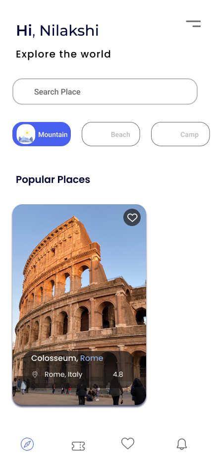

# 🌍 Travel App Design | UI/UX Project

## 🔗 Figma Design

[View My Travel App Design on Figma](https://www.figma.com/design/1RQk0w7QyXb6h79yicKJyU/Travel-App-Design?node-id=0-1)

## 📌 Project Overview
Travel App Design is a personal UI/UX project created in Figma. The project explores a modern travel-themed digital interface with a focus on usability, visual consistency, and user-centered design.

## 🎯 Project Objectives
- Create a clean and engaging travel app interface
- Practice user-centered UI/UX design principles
- Improve navigation and visual hierarchy
- Develop practical Figma design skills

## 🛠️ Tools Used: Figma, UI/UX Design

## 🖼️ Design Preview: 

## 🔗 Figma Design: [View My Figma Design](https://www.figma.com/design/1RQk0w7QyXb6h79yicKJyU/Travel-App-Design?node-id=0-1)
Design Focus: Visual hierarchy, layout, typography, and color consistency.
Future Improvements: Additional screens, responsive layouts, and usability testing.
